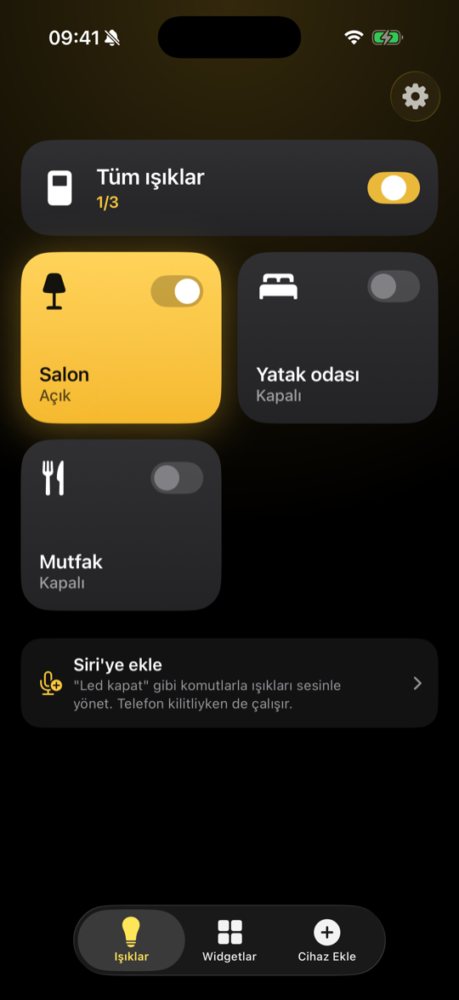
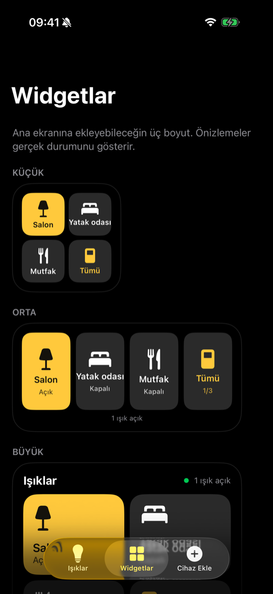
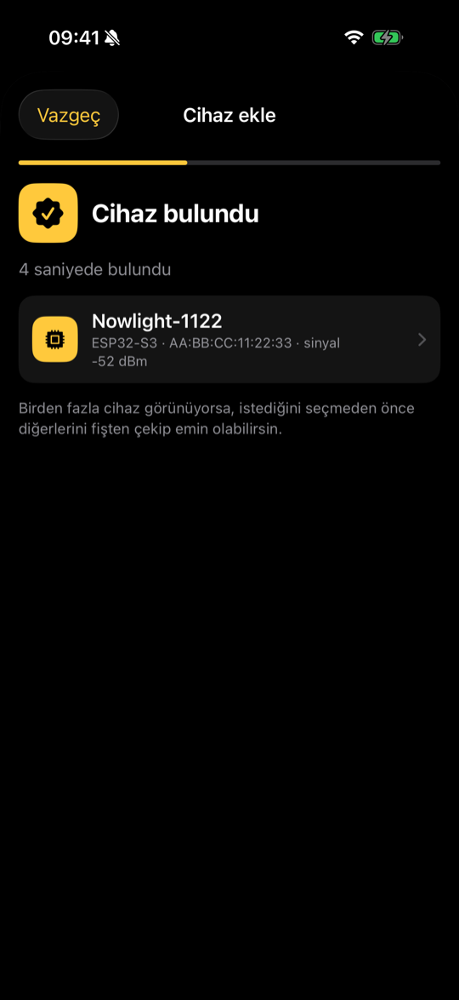
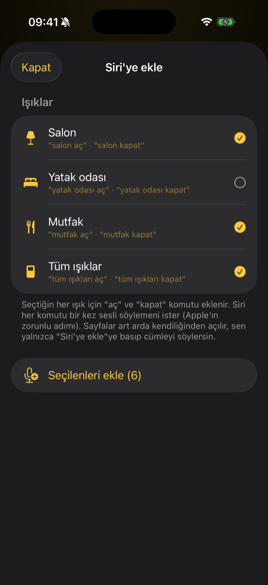
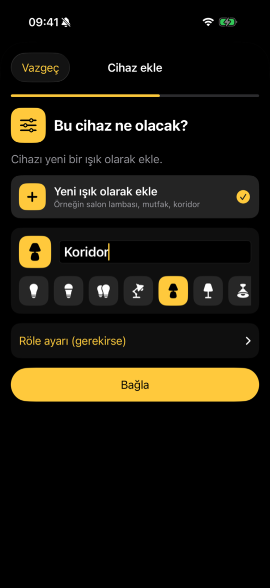

# Nowlight

*ESP32 Light Controller: open-source room lighting over ESP-NOW.*

<p align="center">
  
  
  
  
</p>
<p align="center"><sub>iOS app (Turkish interface): lights, widgets, guided pairing, Siri commands.</sub></p>

**Parts of the system:** a CYD touch panel for the wall or door ([`firmware/controller-cyd`](firmware/controller-cyd)), the lamp nodes ([`firmware/hub`](firmware/hub), [`firmware/bed-node`](firmware/bed-node)), a WiFi phone bridge ([`firmware/bridge`](firmware/bridge)), generic pairable light nodes ([`firmware/node`](firmware/node)), a door PIR node ([`firmware/door`](firmware/door)) and the iOS app with widgets ([`ios`](ios)).


**🇬🇧** A **touch panel (ESP32 "CYD") and an iOS app** that switch lamps (and later an LED strip) over **ESP-NOW**: no internet, no router, no WiFi needed (the devices never appear in WiFi network lists).
**🇹🇷** ESP-NOW ile **internetsiz çalışan dokunmatik ışık paneli (ESP32 CYD) ve iOS uygulaması**. Router/WiFi gerekmez.

> 🇹🇷 Türkçe README: [README.tr.md](README.tr.md). The install guide, hardware and troubleshooting docs are available in English ([`docs/en`](docs/en)); the design notes and code comments are in Turkish.

```
 +--------------+  ESP-NOW  +---------------------+
 |  Wall panel  |<--------->|  Desk node (hub)    |-- relay -- desk lamp
 |  ESP32 CYD   |           |  ESP32 / S3 Mini    |-- foil tape (touch switch)
 |  2.8" touch  |  ESP-NOW  +---------------------+
 |  (USB power) |<--------->+---------------------+
 +--------------+           |  Bed node (ESP32-S3)|-- relay -- bedside lamp
                            +---------------------+
     All three meet on one fixed ESP-NOW channel (NOW_CHANNEL)
```

## Set up the bridge (once per home)

Open **https://flash.matestudios.online**, choose **Bridge**, pick your board, plug it in by USB and press **Install**. When the install finishes the page asks for your WiFi (Improv): enter it there, nothing to type in a terminal. In the app: **Add Device → Bridge settings → Find bridge automatically**. The bridge creates its own random ESP-NOW network key on first boot and follows your router's WiFi channel. Light nodes are then added as above.

## Add a new light (web installer + app)

1. Open **https://flash.matestudios.online** in Chrome or Edge, pick your board (ESP32-S3 / C3 / C6 / S2 / classic ESP32), plug it in by USB and press **Install**. No tools or drivers needed.
2. Connect a relay module to the board (signal GPIO5, or GPIO23 on classic ESP32; 5 V and GND).
3. In the iOS app: **Add Device → Add device**. The new board shows up as `Nowlight-XXXX`; add it as a new light, choose a name and icon, tap **Connect**.

The ESP-NOW network key never travels in clear text: it is delivered during a 2-minute pairing window with X25519 key exchange and AES-GCM ([`firmware/node`](firmware/node), [`firmware/shared/pair_proto.h`](firmware/shared/pair_proto.h)). Up to 7 lights in total. See also: [video script](docs/video-senaryosu.md) (Turkish), [CI](docs/ci.md).

## Features

**Wall panel (CYD, ESP32-2432S028R, 2.8" 320x240, LVGL 8.3)**
- Home screen with a 4, 3, 2 or 1-tile layout; tile order and visibility are editable on the device.
- Big on/off tile per lamp with a status colour, plus an "all lights" tile.
- Settings (gear, top right): layout, display (brightness, auto brightness from the light sensor, flip screen, screen-off timeout) and status (signal strength, channel, touch calibration).
- Turkish (with Turkish glyphs) or English UI, chosen at build time. First boot runs a 4-corner touch calibration.
- Warns when the hub or bed node is unreachable; commands are acknowledged and rolled back on failure.

**Desk node / hub (ESP32-S3 Super Mini):** capacitive-touch switch (aluminium foil tape), relay, ESP-NOW link to the panel. ESP-NOW only, no WiFi and no Apple Home.

**Bed node (ESP32-S3 Super Mini):** ESP-NOW only (no WiFi at all), relay, always boots **off**.

**Reliability:** absolute-value commands acknowledged by an application-level reply (not the radio ACK), retries, on-screen rollback on failure; the radio of all devices is locked to one fixed channel, so nothing depends on a router (SpanPoint's own channel scanning is avoided, see [architecture](docs/architecture.md), Turkish).

**Phone app (iOS):** home-screen widgets (up to 8 lights), rename lights and pick icons, guided pairing of new light nodes, door-sensor automation rules, wireless bridge updates, and **Siri commands that work while the phone is locked** ("led off": one tap adds them for every light, see [ios/README.md](ios/README.md)).

## Screens

**iOS app** (Turkish interface): the lights screen, home-screen widgets (up to 8 lights), guided pairing of a new light (found, then name and icon) and one-tap Siri commands that also work while the phone is locked.

<p align="center">
  
  
  
  
  
</p>

## Hardware

| Qty | Part | Notes |
|---|---|---|
| 1 | **ESP32-2432S028R ("CYD")**, 2.8" 320x240 touch | Wall/door panel (USB powered). The `firmware/controller-cyd` project targets this board |
| 2 | ESP32-S3 Super Mini | Hub and bed node |
| 2 | 1-channel 5 V relay module (**active-low**) | Switches the lamp's phase wire |
| 1 | Aluminium foil tape | Touch switch on the hub |
| 2 | 5 V USB adapters (>=1 A) | Hub and bed node (they also power the relay) |

Pins, wiring and mains safety: [docs/en/hardware.md](docs/en/hardware.md).

## Quick start

> **Full step-by-step guide with a check after every stage: [docs/en/setup.md](docs/en/setup.md).** Mains wiring comes last.

1. Install [PlatformIO](https://platformio.org/) (`pip install -U platformio`) and clone this repo.
2. Read the boards' MAC addresses (`esptool --port <PORT> read-mac`), copy `firmware/shared/now_config.example.h` to **`now_config.h`** (git-ignored) and fill in the MACs (`NOW_CONTROLLER_MAC` is the CYD's MAC), the ESP-NOW channel (`NOW_CHANNEL`, default 1) and an ESP-NOW passphrase.
3. Test the relay polarity with `firmware/tools/relay-test` (no mains needed).
4. In each of `firmware/controller-cyd` (`-e cyd` Turkish or `-e cyd-en` English), `firmware/hub`, `firmware/bed-node`: `pio run -t upload --upload-port <PORT>`.

## Documentation

**English** ([`docs/en`](docs/en)):

| Doc | Content |
|---|---|
| [setup.md](docs/en/setup.md) | **Step-by-step install guide** (stages with checks, mains last) |
| [hardware.md](docs/en/hardware.md) | BOM, pins, relay wiring, terminal identification, **mains safety**, power |
| [troubleshooting.md](docs/en/troubleshooting.md) | Install, ESP-NOW and panel problems with fixes |

**Turkish** ([`docs`](docs)): the same guides plus deeper design notes:

| Doc | Content |
|---|---|
| [architecture.md](docs/architecture.md) | Roles, data flow, reliability, channel handling |
| [protocol.md](docs/protocol.md) | 9-byte `NowMsg`, flows, how to add a node (e.g. LED strip) |

Helper tool: [`firmware/tools/relay-test`](firmware/tools/relay-test) (relay polarity, no mains needed).

## Status

| Component | Status |
|---|---|
| Wall panel (CYD) | Tested on real hardware |
| Bed node | Tested on real hardware (ESP32-S3 Super Mini + 5 V relay) |
| Desk node for ESP32-S3 Super Mini | **Compiles, NOT hardware-tested.** The author's desk node is a classic ESP32 running the same logic. Touch readings *rise* on S3 and *fall* on the classic ESP32; see [docs/en/hardware.md](docs/en/hardware.md#hub-touch-switch) for tuning (`TOUCH_DEBUG`, `TOUCH_DELTA_PCT`) |
| LED strip node | Planned (the protocol already reserves a device slot) |

Known limitations: the CYD's light sensor works inverted (the firmware compensates); the ESP-NOW link to the bed node can lose a few packets if the node sits near metal or mains wiring (commands are retried and idempotent).

## ⚠️ Safety

The relay switches **mains voltage**. Only wire it if you know what you are doing, switch the breaker off first, keep every mains connection in a closed insulated enclosure, and ask an electrician if unsure. No warranty; use at your own risk.

## Contributing

Issues and pull requests are welcome, especially: a tested ESP32-S3 hub configuration, an LED-strip node, and English translations of the design notes (`architecture.md`, `protocol.md`).

## License and credits

- This repository's own code: [MIT](LICENSE).
- Third-party files (details in [THIRD_PARTY_NOTICES.md](THIRD_PARTY_NOTICES.md)):
  - `firmware/controller-cyd/src/fonts/`: generated with LVGL's font converter from Montserrat (SIL Open Font License 1.1).
- Libraries (downloaded at build time): [LVGL](https://lvgl.io) (MIT), [TFT_eSPI](https://github.com/Bodmer/TFT_eSPI) (BSD-style), [XPT2046_Touchscreen](https://github.com/PaulStoffregen/XPT2046_Touchscreen) (MIT), [HomeSpan](https://github.com/HomeSpan/HomeSpan) (MIT, used only for its ESP-NOW `SpanPoint` class).
