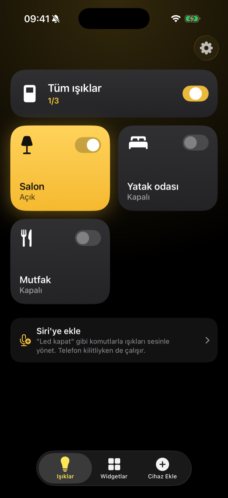
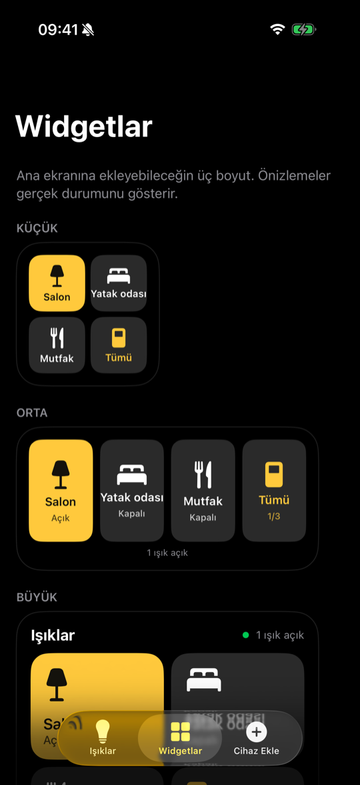
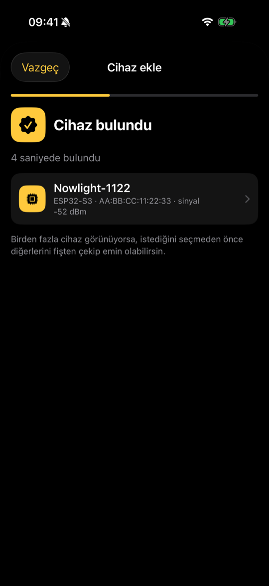
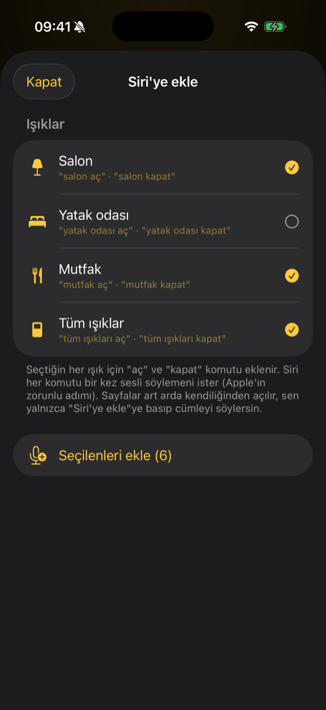
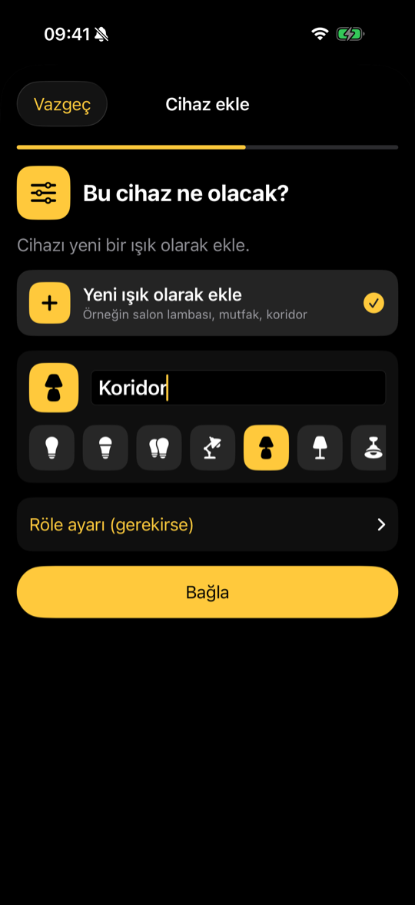

# Nowlight

*ESP32 Light Controller: ESP-NOW ile açık kaynak oda aydınlatması.*

<p align="center">
  
  
  
  
</p>
<p align="center"><sub>iOS uygulaması: ışıklar, widget'lar, rehberli eşleme, Siri komutları.</sub></p>

**Sistemin parçaları:** duvar/kapı için CYD dokunmatik panel ([`firmware/controller-cyd`](firmware/controller-cyd)), lamba düğümleri ([`firmware/hub`](firmware/hub), [`firmware/bed-node`](firmware/bed-node)), telefon için WiFi köprüsü ([`firmware/bridge`](firmware/bridge)), eşleştirilebilir genel ışık düğümleri ([`firmware/node`](firmware/node)), kapı PIR düğümü ([`firmware/door`](firmware/door)) ve widget'lı iOS uygulaması ([`ios`](ios)).


ESP-NOW ile çalışan **dokunmatik ışık paneli (ESP32 CYD) ve iOS uygulaması**. Masa ve yatak lambasını, ileride LED şeridi, internet olmadan da kontrol eder. Router, modem ya da WiFi gerekmez; cihazlar WiFi ağ listesinde de görünmez.

> 🇬🇧 English (main README): [README.md](README.md)

```
   +----------------+   ESP-NOW   +------------------------+
   |  Duvar paneli  |<----------->|  Masa düğümü (hub)     |--- role --- masa lambasi
   |  ESP32 CYD     |             |  ESP32 / S3 Super Mini |--- alüminyum bant (dokunma)
   |  2.8" ekran    |   ESP-NOW   +------------------------+
   |  (USB güç)     |<----------->+------------------------+
   +----------------+             |  Yatak düğümü          |--- role --- yatak lambasi
                                  |  ESP32-S3 Super Mini   |
                                  +------------------------+
        Üç cihaz sabit bir ESP-NOW kanalında buluşur (NOW_CHANNEL)
```

## Köprüyü kur (evde bir kez)

**https://flash.matestudios.online** sayfasında **Köprü**'yü seç, kartını seç, USB ile tak ve **Yükle**'ye bas. Yükleme bitince sayfa WiFi bilgisini sorar (Improv): orada gir, terminale bir şey yazman gerekmez. Uygulamada: **Cihaz Ekle → Köprü ayarları → Köprüyü otomatik bul**. Köprü ilk açılışta kendi rastgele ESP-NOW ağ anahtarını üretir ve router'ın WiFi kanalını izler. Işık düğümleri yukarıdaki gibi eklenir.

## Yeni ışık ekleme (web yükleyici + uygulama)

1. Chrome ya da Edge ile **https://flash.matestudios.online** sayfasını aç, kartını seç (ESP32-S3 / C3 / C6 / S2 / klasik ESP32), USB ile tak ve **Yükle**'ye bas. Program ya da sürücü gerekmez.
2. Karta bir röle modülü bağla (sinyal GPIO5, klasik ESP32'de GPIO23; 5V ve GND).
3. iOS uygulamasında: **Cihaz Ekle → Cihaz ekle**. Yeni kart `Nowlight-XXXX` adıyla çıkar; yeni ışık olarak ekle, ad ve simge seç, **Bağla**'ya bas.

ESP-NOW ağ anahtarı düz metin gitmez: 2 dakikalık eşleşme penceresinde X25519 anahtar değişimi ve AES-GCM ile iletilir ([`firmware/node`](firmware/node), [`firmware/shared/pair_proto.h`](firmware/shared/pair_proto.h)). Toplam en fazla 7 ışık. Ayrıca: [video senaryosu](docs/video-senaryosu.md), [CI](docs/ci.md).

## Özellikler

**Duvar paneli (CYD, ESP32-2432S028R, 2.8" 320x240, LVGL 8.3)**
- Ana ekran 4'lü, 3'lü, 2'li ya da 1'li karo düzeninde; karo sırası ve gizleme cihazdan ayarlanır.
- Her lamba için büyük açma/kapama karosu (duruma göre renk) ve "tüm ışıklar" karosu.
- Ayarlar (sağ üstte dişli): düzen, ekran (parlaklık, ışık sensöründen otomatik parlaklık, ekranı çevir, ekran kapanma süresi) ve durum (sinyal gücü, kanal, dokunmatik kalibrasyonu).
- Türkçe (Türkçe harfli yazı tipiyle) ya da İngilizce arayüz, derlemede seçilir. İlk açılışta 4 köşeli dokunmatik kalibrasyonu yapılır.
- Hub/yatak ulaşılamazsa uyarır; komutlar onaylanır, başarısız olursa geri alınır.

**Masa düğümü / hub (ESP32-S3 Super Mini)** — kapasitif dokunma bandı ile açma/kapama, röle, panel ile ESP-NOW. WiFi/Apple Home yok.

**Yatak düğümü (ESP32-S3 Super Mini)** — Sadece ESP-NOW, WiFi/modem yok. Elektrik gelince lamba her zaman kapalı başlar.

**Telefon uygulaması (iOS):** ana ekran widget'ları (en fazla 8 ışık), ışıkları yeniden adlandırma ve simge seçme, yeni ışık düğümlerini rehberle eşleme, kapı sensörü otomasyon kuralları, köprüyü kablosuz güncelleme ve **telefon kilitliyken de çalışan Siri komutları** ("led kapat": tek dokunuşla tüm ışıklar için eklenir, bkz. [ios/README.md](ios/README.md)).

## Ekranlar

**iOS uygulaması:** ışıklar ekranı, ana ekran widget'ları (en fazla 8 ışık), yeni ışığın rehberli eşlemesi (bulundu, sonra ad ve simge) ve telefon kilitliyken de çalışan tek dokunuşluk Siri komutları.

<p align="center">
  
  
  
  
  
</p>

## Depo yapısı

| Klasör | İçerik |
|---|---|
| [`firmware/controller-cyd`](firmware/controller-cyd) | Duvar/kapı paneli yazılımı (CYD, PlatformIO, LVGL 8.3) |
| [`firmware/hub`](firmware/hub) | Masa düğümü / hub yazılımı (ESP32-S3 Super Mini) |
| [`firmware/bed-node`](firmware/bed-node) | Yatak düğümü yazılımı |
| [`firmware/shared`](firmware/shared) | Ortak ESP-NOW protokolü ve kişisel ayar şablonu |
| [`docs`](docs) | Mimari, donanım, protokol, kurulum, sorun giderme |

## Hızlı başlangıç

> **Her aşamada kontrol içeren tam rehber: [docs/setup.md](docs/setup.md).** 220V bağlantısı en sonda yapılır.

1. [PlatformIO](https://platformio.org/) kur (`pip install -U platformio`), depoyu indir.
2. Kartların MAC adresini oku (`esptool --port <PORT> read-mac`), `firmware/shared/now_config.example.h` dosyasını **`now_config.h`** olarak kopyala (git'e girmez) ve MAC'leri (`NOW_CONTROLLER_MAC` = CYD'nin MAC'i), ESP-NOW kanalını (`NOW_CHANNEL`, varsayılan 1) ve bir ESP-NOW parolasını doldur.
3. Rölenin mantığını `firmware/tools/relay-test` ile doğrula (220V gerekmez).
4. `firmware/controller-cyd` (`-e cyd` Türkçe, `-e cyd-en` İngilizce), `firmware/hub`, `firmware/bed-node` klasörlerinin her birinde `pio run -t upload --upload-port <PORT>`.

## Dokümanlar

- [Mimari ve tasarım kararları](docs/architecture.md)
- [Donanım, pinler, kablolama, 220V güvenliği](docs/hardware.md)
- Yardımcı araç: [`firmware/tools/relay-test`](firmware/tools/relay-test) (röle mantığı, 220V gerekmez)
- 🇬🇧 English guides: [docs/en](docs/en)
- [ESP-NOW protokolü](docs/protocol.md)
- [Kurulum](docs/setup.md)
- [Sorun giderme ve öğrenilen dersler](docs/troubleshooting.md)

## Durum

| Bileşen | Durum |
|---|---|
| Duvar paneli (CYD) | Gerçek donanımda test edildi |
| Yatak düğümü | Gerçek donanımda test edildi (ESP32-S3 Super Mini + 5V röle) |
| Hub (ESP32-S3 Super Mini) | **Derleniyor, donanımda test EDİLMEDİ.** Yazarın kendi hub'ı klasik bir ESP32 (aynı mantık, aynı kod tabanı). Dokunma eşiği S3'te farklı davranır, bkz. [docs/hardware.md](docs/hardware.md#hub-dokunma-bandı) |
| LED şerit düğümü | Planlandı, yazılmadı (protokolde yeri hazır) |

## ⚠️ Güvenlik

Röle, **220V şebeke gerilimini** anahtarlar. Bağlantıyı yalnızca ne yaptığını biliyorsan yap, **sigortayı kapat**, tüm yüksek gerilim bağlantılarını kapalı ve yalıtkan bir kutuda tut, emin değilsen bir elektrikçiye yaptır. Ayrıntılar: [docs/hardware.md](docs/hardware.md#220v-tarafı-güvenlik). Bu depo garanti vermez, kullanım sorumluluğu sana aittir.

## Lisans ve atıflar

Üçüncü taraf dosyalar için: [THIRD_PARTY_NOTICES.md](THIRD_PARTY_NOTICES.md).

- Bu deponun kendi kodu: [MIT](LICENSE).
- `firmware/controller-cyd/src/fonts/`: LVGL'nin yazı tipi dönüştürücüsüyle Montserrat'tan (SIL Open Font License 1.1) üretildi.
- Kullanılan kütüphaneler: [LVGL](https://lvgl.io) (MIT), [TFT_eSPI](https://github.com/Bodmer/TFT_eSPI) (BSD tarzı), [XPT2046_Touchscreen](https://github.com/PaulStoffregen/XPT2046_Touchscreen) (MIT), [HomeSpan](https://github.com/HomeSpan/HomeSpan) (MIT, yalnızca ESP-NOW/`SpanPoint` sınıfı için).
